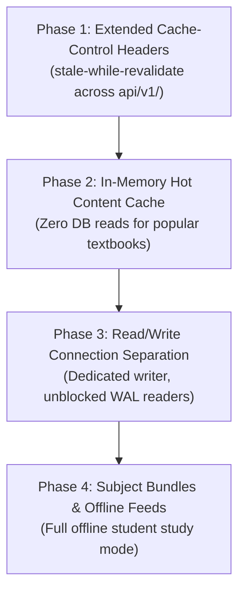

# System Review: High Performance Content Serving and Zero Latency Architecture

**Review Timestamp**: 2026-11-17 07:33:00 UTC+1  
**Project**: utmelab-api  
**Service Version**: v0.0.10  
**Scope**: All content serving surfaces under `/api/v1/` (textbooks, syllabus, questions, exams, notes, traps)

---

## 1. Executive Summary

Educational curricula, textbooks, syllabus trees, past questions, and misconception traps are structurally stable data. Unlike financial balances or chat streams, a physics chapter on Newton's laws or a JAMB mathematics syllabus tree rarely changes once verified and published. Updates occur during formal curriculum revisions or batch content imports.

Because content staleness is rare, the current serving model is over conservative. Many endpoints still touch disk, query SQLite, and parse relational schemas on every single HTTP request.

This document reviews how to apply aggressive caching, dedicated connection separation, long term edge survival, and offline client bundles across the entire `/api/v1/` surface.

---

## 2. Analysis of the `/api/v1/` Content Surfaces

The API currently divides into several distinct surfaces under `/api/v1/`:

| Surface | Endpoints | Content Change Frequency | Current Bottleneck |
| :--- | :--- | :--- | :--- |
| **Public Discovery** | `/api/v1/public/summary`, `/api/v1/public/exams`, `/api/v1/public/syllabus/*` | Months / Years | Generates counts and JSON trees from disk |
| **Textbooks** | `/api/v1/textbooks`, `/api/v1/textbooks/:id` | Semesters / Editions | Joins books, parts, and chapter counts |
| **Chapters & Sections** | `/api/v1/chapters/:id`, `/api/v1/chapters/:id/sections/:sec` | Semesters / Editions | Parses large structured content blocks from SQLite |
| **Exam Traps & Checks** | `/api/v1/exam-traps`, `/api/v1/chapters/:id/exercises` | Semesters / Editions | Queries indexed tables; returns 10KB to 20KB arrays |
| **Questions & Papers** | `/api/v1/questions`, `/api/v1/papers/assemble`, `/api/v1/papers/score` | Exam cycles (yearly) | Filters questions and validates options |
| **Notes** | `/api/v1/notes/:slug` | Months | Fetches static markdown/structured notes |

Because content updates occur in bulk batches (via `import-chapters`, `import-notes`, or cloud synchronization), content is effectively immutable between release events.

---

## 3. Four Core Architectural Improvements

### A. In-Memory Hot Cache for Read Surfaces

#### Current State
Each request to `/api/v1/chapters/:id` or `/api/v1/textbooks` checks out a connection from `ConnPool`, executes SQL statements against SQLite, deserializes JSON columns, and formats the response. Even though local response times are fast (2ms to 10ms), this consumes thread pool capacity and connection gate permits under load.

#### Proposed Design
Implement an in-memory cache layer in the application state:
1. Cache entries store pre serialized response payloads or structured models in memory.
2. The cache key includes the resource identifier and the active `bank_version`:
   ```rust
   let cache_key = format!("{}:{}", bank_version, request_path_and_query);
   ```
3. When a read request arrives, the handler checks memory first. If present, it returns immediately without checking out a database connection or touching SQLite.
4. When `bank_version` advances (after a cloud pull or local batch write), the cache automatically invalidates or swaps generations.

#### Expected Performance
- Memory lookup latency: sub 100 microseconds (0.1ms).
- Database connection checkout count: zero for hot paths.
- Throughput capacity: tens of thousands of requests per second per core.

---

### B. Dedicated Read Connection Isolation

#### Current State
Readers and writers share a 16 permit `DbGate` and a single `ConnPool`. While writers lock `write_mutex`, they also check out connections from the shared pool.

#### Proposed Design
Isolate read connections from write operations:
1. Maintain a dedicated read-only connection pool for all `/api/v1/` read handlers.
2. Provide a single dedicated write connection for background synchronization and data imports.
3. Under SQLite WAL (Write-Ahead Logging) mode, read transactions never block write transactions, and write transactions never block read transactions.
4. Reads never queue behind writes, ensuring zero database saturation errors (503) for students browsing content.

---

### C. Aggressive Edge and Browser Cache Headers

#### Current State
Cached endpoints specify:
```http
Cache-Control: public, max-age=300
```
When five minutes elapse, downstream caches (browsers, CDNs, or reverse proxies) must round-trip back to origin to revalidate with `If-None-Match`.

#### Proposed Design
Since textbook and exam content does not decay, configure modern cache headers across all read surfaces:
```http
Cache-Control: public, max-age=86400, stale-while-revalidate=604800, stale-if-error=2592000
```

#### How Downstream Caches Behave Under This Policy
1. **Fresh Window (`max-age=86400`, 24 hours)**: Downstream caches serve the response immediately with zero network requests to origin.
2. **Revalidation Window (`stale-while-revalidate=604800`, 7 days)**: The edge or browser serves the cached content instantly to the user while fetching an updated version in the background. The user perceives zero latency.
3. **Emergency Fallback (`stale-if-error=2592000`, 30 days)**: If the backend API is rebooting, under maintenance, or unreachable, edge servers continue serving existing content for up to 30 days instead of showing an error.

---

### D. Offline Bundles and Client Storage

#### Current State
Clients make separate HTTP calls to fetch books, outlines, sections, exercises, and traps. If a student loses internet access while studying, navigation stops.

#### Proposed Design
Provide bundle endpoints that package complete subject curricula into single archives:
1. **Bundle Endpoint**:
   `GET /api/v1/sync/bundle?subject=physics&exam=JAMB`
   Returns the textbook chapters, sections, exercises, exam traps, and recall checks in a single gzip compressed JSON document.
2. **Client Local Storage**:
   Mobile and desktop applications download the bundle once and store it in local IndexedDB or SQLite.
3. **Zero Latency Operation**:
   All subsequent chapter navigation, formula lookups, and practice questions execute against local storage.
4. **Lightweight Delta Sync**:
   Clients only query the API to check if `bank_version` or chapter content hashes changed. If unchanged, zero data transfer occurs.

---

## 4. Implementation Roadmap



### Phase 1: Cache Control & ETag Hardening
- Extend `src/api/middleware.rs` to emit `stale-while-revalidate` and `stale-if-error`.
- Ensure all textbook and question list handlers emit stable `ETag` hashes.

### Phase 2: In-Memory Hot Read Cache
- Add an in-memory cached content store into `AppState`.
- Wrap chapter, book, and trap handlers with memory lookups.
- Invalidate the cache when `s.sync` records new write commits or pull completions.

### Phase 3: Read Connection Pool Isolation
- Split `DbState` connection management into distinct reader and writer channels.
- Configure read connections in read-only query mode (`query_only=ON`).

### Phase 4: Offline Subject Bundles
- Create `/api/v1/sync/bundle` route.
- Implement streaming compression for complete subject bundles.
- Provide client schema guides for IndexedDB and SQLite persistence.

---

## 5. Conclusion

Because educational curriculum content is stable, the API should treat content as permanent assets with rare invalidations. By coupling in-memory serving, long-term stale-while-revalidate policies, and offline client bundles, the service can achieve consistent sub-millisecond response times and uninterrupted student availability.
