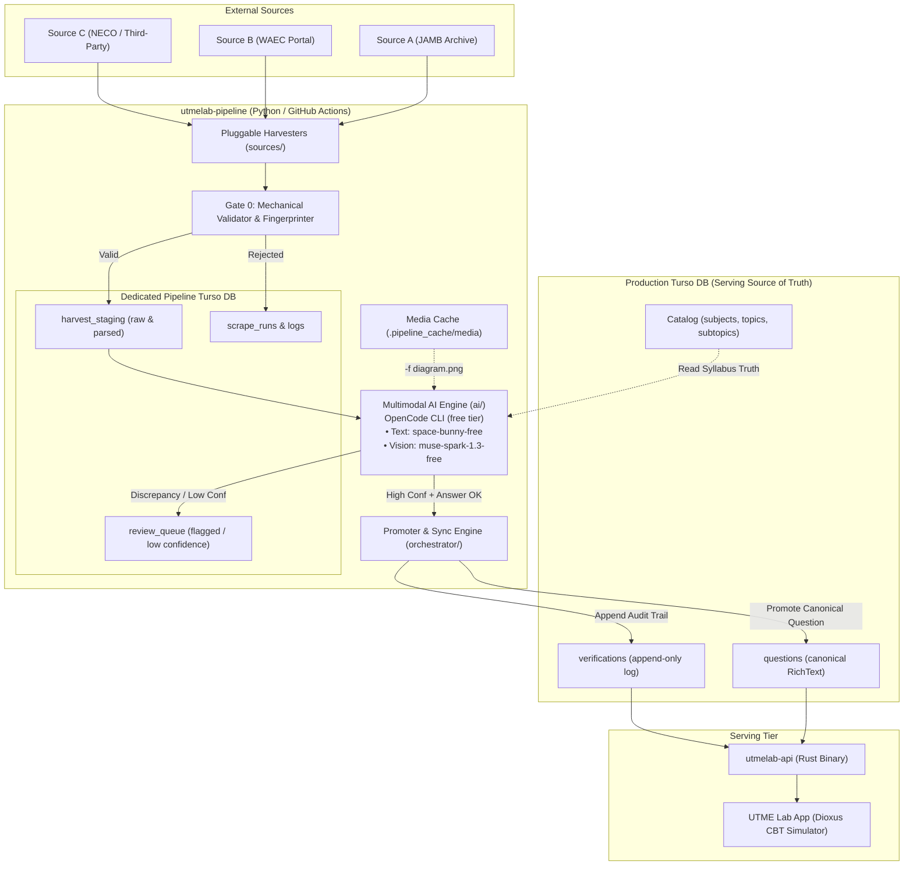

# Pipeline Architecture — utmelab-pipeline

**Status:** Living Architectural Specification (2026-10-14)  
**Parent System:** UTME Lab (`utmelab` / `utmelab-api`)  
**Scope:** Autonomous Data Acquisition, Mechanical Filtering, Multimodal AI Verification, and Promotion Engine.

---

## 1. Executive Summary & Philosophy

`utmelab-pipeline` is an enterprise-grade, standalone Python system responsible for populating, verifying, and maintaining the content moat for UTME Lab (JAMB, WAEC, NECO).

### Separation of Concerns
1. **The Rust API (`utmelab-api`)**: Serves verified content with sub-millisecond latencies, enforces API key rate limits, serves static docs, and delivers deterministic exam paper assembly. It **never** crawls or runs heavy AI tasks.
2. **The Production Turso DB**: The single, authoritative store of truth for verified questions, syllabi, blueprints, and append-only verification logs.
3. **The Pipeline (`utmelab-pipeline`)**: The external data factory. It harvests from diverse external sources, performs zero-cost mechanical gating, executes multimodal AI reasoning at scale via the OpenCode free tier, and manages the promotion pipeline.
4. **Dedicated Pipeline Turso DB**: All raw scrapes, processing states, failure analyses, and review queues live in a separate Turso database to eliminate write contention and maintain total isolation from production serving.



---

## 2. Core Architectural Pillars

### Pillar 1: Pluggable Multi-Source Ingestion
External sources have vastly different payload formats, pagination schemes, and anti-scraping quirks.
- All sources implement `BaseHarvester` (`pipeline/sources/base.py`).
- Every harvester outputs a standardized `RawQuestionPayload`.
- Adding a new exam body or third-party portal requires only creating an isolated adapter without touching downstream validation or AI logic.

### Pillar 2: Gate 0 Mechanical Filtering (Zero Token Cost)
No malformed, incomplete, or duplicate question should ever consume compute or LLM tokens.
- **Fingerprinting**: Normalized text hashing (SHA-256 of lowercase, stripped stem) detects existing questions across the pipeline and production banks immediately.
- **Structural Integrity**: Validates presence of 4 distinct options (or 4–5 for WAEC), single correct answer, and non-empty stem.
- **Media Pre-Flight**: If a stem contains figure hints (*"as shown in the diagram"*, *"refer to figure 2"*), an accompanying media URL must be present and reachable via HTTP `HEAD`/`GET`. If missing, it is rejected at the gate.

### Pillar 3: Zero-Cost Multimodal AI Verification
Human-level question review and syllabus tagging at scale is achieved without paid API overhead:
- **CLI over Stdin Seam**: Uses the OpenCode CLI (`opencode run`) invoked as a subprocess with prompt payloads piped via `stdin`. This bypasses shell argument limits and prevents algebra expressions (like `-3x`) from being misinterpreted as CLI flags.
- **Multimodal Image Support**: For diagram-based questions, `pipeline/media/downloader.py` caches the image locally and passes it via `--file / -f` to `opencode/muse-spark-1.3-contributor-free`.
- **Text Tasks**: Non-diagram items run through `opencode/space-bunny-free` for fast subtopic classification, answer verification, underline identification, and explanation assessment.

### Pillar 4: Dedicated Pipeline Database & Isolated State
- Production stays clean: Only reviewed or high-confidence questions land in the production `questions` table.
- All intermediate states (`harvested`, `gate0_valid`, `ai_processing`, `ai_verified`, `flagged_discrepancy`, `promoted`) live in the dedicated pipeline database in Turso.
- Syllabus definitions (topics, subtopics, learning objectives) are pulled **dynamically** from the production DB at run time to eliminate static JSON drift.

### Pillar 5: Matrix Execution on GitHub Actions
The pipeline is optimized for distributed CI execution:
- Jobs are partitioned across multiple parallel runners using GitHub Actions matrix strategies (e.g. 1 runner per subject or cohort).
- Each runner executes an internal `asyncio` task pool with bounded concurrency to saturate available compute without triggering upstream rate limits.

---

## 3. High-Level Module Structure

```text
utmelab-pipeline/
├── README.md                           # System overview and quick start
├── pyproject.toml                      # Modern packaging with uv / pip
├── docs/                               # Architectural & operational specs
│   ├── ARCHITECTURE.md                 # System overview (this document)
│   ├── DATA_LIFECYCLE_AND_SCHEMA.md    # Turso DDL, state machine, fingerprinting
│   ├── MULTIMODAL_AI_STRATEGY.md       # OpenCode CLI stdin + vision integration
│   ├── HARVESTER_AND_GATES.md          # Multi-source adapters & Gate 0 logic
│   ├── ORCHESTRATION_AND_CICD.md       # GitHub Actions matrix & runner specs
│   └── ROADMAP_AND_MILESTONES.md       # Phased execution milestones
├── .github/
│   └── workflows/
│       ├── harvest_sources.yml         # Scheduled / manual ingestion runs
│       └── ai_process_staging.yml      # Parallel AI tagging & QA verification
├── pipeline/
│   ├── config.py                       # Configuration & environment variables
│   ├── storage/                        # Turso database connection & repos
│   ├── sources/                        # Harvester implementations
│   ├── gates/                          # Mechanical integrity & deduplication
│   ├── media/                          # Image cache and downloader
│   ├── ai/                             # OpenCode CLI provider, prompts, parsing
│   ├── orchestrator/                   # Concurrency pool & promotion engine
│   └── cli.py                          # Unified CLI entry point
└── tests/                              # Pytest test suite
```
