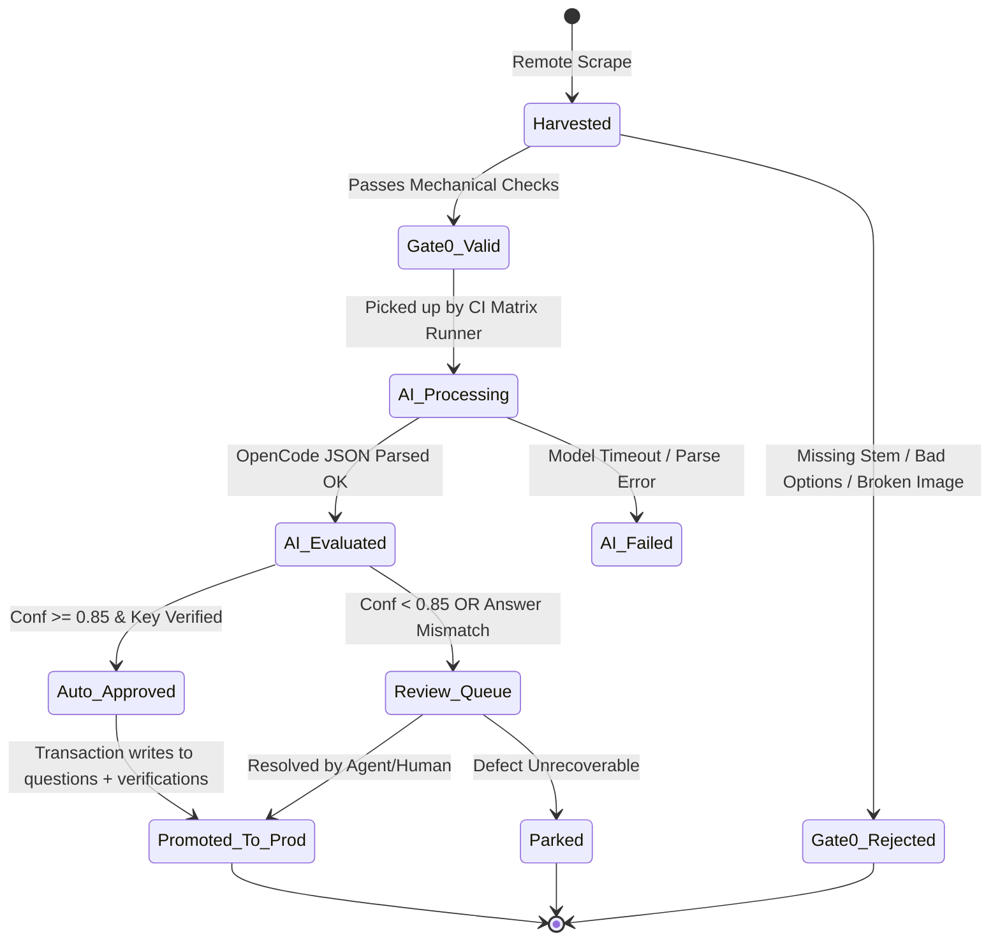

# Data Lifecycle & Database Schema — utmelab-pipeline

**Parent System:** UTME Lab Pipeline  
**Target Engine:** Turso (LibSQL)  
**Specification Date:** 2026-10-14

---

## 1. Dual-Database Architecture

The pipeline interfaces with **two** Turso databases to keep operational staging completely separated from production serving:

| Database | Connection Variable | Role | Permissions |
|---|---|---|---|
| **Pipeline DB** (Dedicated) | `TURSO_PIPELINE_DB_URL`<br>`TURSO_PIPELINE_DB_TOKEN` | Staging, raw payloads, scraping runs, AI proposals, failure logs | **Read / Write** |
| **Production DB** (Serving) | `TURSO_PROD_DB_URL`<br>`TURSO_PROD_DB_TOKEN` | Official catalog (syllabi, blueprints), production questions, verifications | **Read** (Syllabus)<br>**Write** (Atomic Promotion only) |

---

## 2. Pipeline Database Schema (DDL)

```sql
-- 1. Scrape Run Tracking
CREATE TABLE IF NOT EXISTS scrape_runs (
    id TEXT PRIMARY KEY,               -- UUID or timestamp slug (e.g. run_jamb_20261014_01)
    source_name TEXT NOT NULL,         -- e.g. 'jamb_official_archive', 'waec_portal'
    exam TEXT NOT NULL,                -- 'JAMB' | 'WAEC' | 'NECO'
    subject TEXT NOT NULL,
    year INTEGER,
    status TEXT NOT NULL,              -- 'running' | 'completed' | 'failed'
    total_scraped INTEGER DEFAULT 0,
    valid_admitted INTEGER DEFAULT 0,
    rejected_gate0 INTEGER DEFAULT 0,
    started_at TEXT NOT NULL,
    finished_at TEXT,
    error_summary TEXT
);

-- 2. Staging Question Bank
CREATE TABLE IF NOT EXISTS harvest_staging (
    id TEXT PRIMARY KEY,               -- stage_q_<fingerprint[:16]>
    run_id TEXT NOT NULL,              -- FK -> scrape_runs.id
    source_name TEXT NOT NULL,
    source_url TEXT,
    source_item_id TEXT,               -- Original ID from remote source
    exam TEXT NOT NULL,                -- 'JAMB' | 'WAEC' | 'NECO'
    subject TEXT NOT NULL,
    year INTEGER NOT NULL,
    
    -- Mechanical / Raw Data
    stem_raw TEXT NOT NULL,
    options_raw TEXT NOT NULL,         -- JSON array: [{"id": "a", "text": "..."}, ...]
    answer_raw TEXT NOT NULL,          -- Remote reported answer ("a", "b", "c", "d")
    explanation_raw TEXT,              -- Remote explanation if available
    media_url TEXT,                    -- Remote diagram/image URL if any
    
    -- Deduplication & Fingerprint
    fingerprint TEXT NOT NULL UNIQUE,  -- SHA-256 of normalized stem
    
    -- Gate 0 Mechanical Status
    gate0_status TEXT NOT NULL,        -- 'pending' | 'valid' | 'rejected'
    gate0_rejection_reason TEXT,       -- e.g. 'missing_options', 'broken_figure_url'
    
    -- AI Evaluation & Tagging
    ai_status TEXT NOT NULL,           -- 'unprocessed' | 'in_progress' | 'completed' | 'failed'
    proposed_topic TEXT,
    proposed_subtopic TEXT,
    answer_check_verdict TEXT,         -- 'VERIFIED' | 'DISAGREEMENT' | 'AMBIGUOUS'
    explanation_quality TEXT,          -- 'GOOD' | 'PARTIAL' | 'POOR' | 'MISSING'
    proposed_explanation TEXT,         -- JSON: {key_point, body, trap}
    ai_confidence REAL,                -- 0.0 - 1.0
    detected_marks TEXT,               -- JSON array of RichText marks (Underlines, Formulas, Images)
    ai_raw_response TEXT,              -- Verbatim LLM response JSON for audit
    
    -- Overall Pipeline State
    pipeline_status TEXT NOT NULL,     -- 'harvested' | 'ready_for_review' | 'auto_approved' | 'promoted' | 'parked'
    
    created_at TEXT NOT NULL,
    updated_at TEXT NOT NULL,
    FOREIGN KEY(run_id) REFERENCES scrape_runs(id)
);

CREATE INDEX IF NOT EXISTS idx_staging_fingerprint ON harvest_staging(fingerprint);
CREATE INDEX IF NOT EXISTS idx_staging_subject_status ON harvest_staging(subject, pipeline_status);
CREATE INDEX IF NOT EXISTS idx_staging_ai_status ON harvest_staging(ai_status);

-- 3. Review & Exception Queue
CREATE TABLE IF NOT EXISTS review_queue (
    question_id TEXT PRIMARY KEY,      -- FK -> harvest_staging.id
    subject TEXT NOT NULL,
    exam TEXT NOT NULL,
    flag_reason TEXT NOT NULL,         -- 'answer_mismatch' | 'low_confidence' | 'missing_figure' | 'hallucinated_subtopic'
    priority INTEGER DEFAULT 1,        -- 1 = high, 5 = low
    reviewer TEXT,                     -- Agent or human username
    review_status TEXT NOT NULL,       -- 'open' | 'in_review' | 'resolved' | 'discarded'
    resolution_notes TEXT,
    created_at TEXT NOT NULL,
    resolved_at TEXT,
    FOREIGN KEY(question_id) REFERENCES harvest_staging(id)
);

CREATE INDEX IF NOT EXISTS idx_review_status_prio ON review_queue(review_status, priority);
```

---

## 3. Fingerprinting & Deduplication Logic

To prevent redundant downloads, crawling, or AI processing, every question is fingerprinted using a normalized SHA-256 hash:

```python
import hashlib
import re

def compute_fingerprint(stem: str) -> str:
    """Canonicalize stem text to prevent re-harvesting duplicate questions.
    
    1. Strip HTML tags and markdown markers.
    2. Lowercase all characters.
    3. Collapse all whitespace sequences into a single space.
    4. Strip leading/trailing punctuation and whitespace.
    """
    clean = re.sub(r'<[^>]+>', '', stem)
    clean = re.sub(r'\s+', ' ', clean).strip().lower()
    return hashlib.sha256(clean.encode('utf-8')).hexdigest()
```

- When the harvester finishes scraping a question, it queries `harvest_staging` by `fingerprint`.
- If the fingerprint already exists in `harvest_staging` or in the production `questions` table (`content_hash`), the scrape is recorded as a duplicate and immediately skipped.

---

## 4. State Transition Machine



---

## 5. Promotion Transaction to Production Turso

When a question reaches `Auto_Approved` or is resolved from `Review_Queue`, the promotion engine executes an atomic write to the Production Turso database:

1. **Format into Canonical RichText**:
   - Stem: `{"text": "...", "inline": [...]}`
   - Options: `[{"id": "a", "text": {"text": "...", "inline": []}}, ...]`
   - Explanation: `{"key_point": {"text": "...", "inline": []}, "body": {"text": "...", "inline": []}, "trap": {"text": "...", "inline": []}}`
2. **Compute `content_hash`**:
   Matches Rust's `store.rs` content hash computation to guarantee hash-invariance.
3. **Atomic Production Insertion**:
   - `INSERT INTO questions (...) VALUES (...)`
   - `INSERT INTO verifications (id, question_id, kind, verdict, verifier, content_hash, created_at) VALUES (...)`
4. **Mark Staging Row**:
   - Update `harvest_staging.pipeline_status = 'promoted'`.
