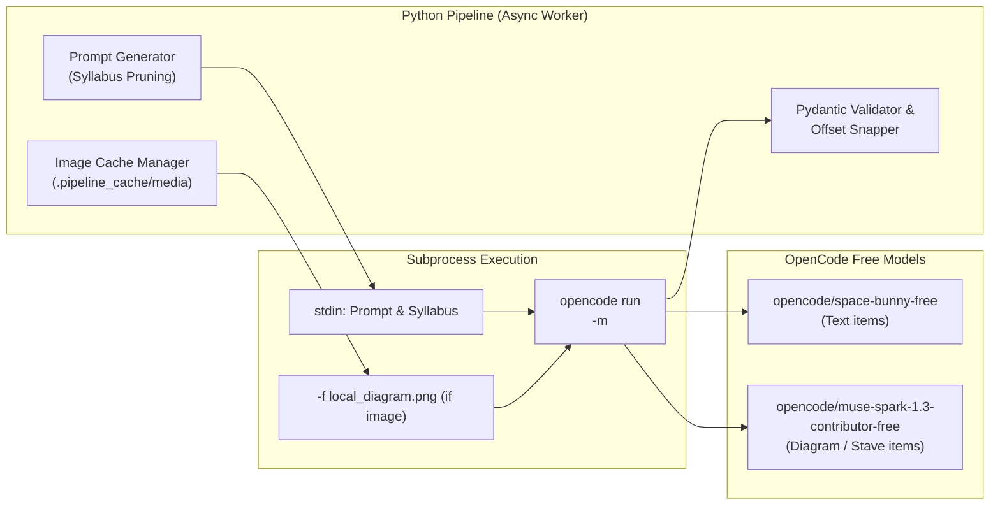

# Multimodal AI Strategy & OpenCode Engine — utmelab-pipeline

**Parent System:** UTME Lab Pipeline  
**Model Provider:** OpenCode Free Tier (Zen CLI)  
**Specification Date:** 2026-10-14

---

## 1. Zero-Cost Engine Architecture

To scale verification, auto-tagging, and diagram reading across thousands of questions without API billing or rate limits, `utmelab-pipeline` leverages the OpenCode CLI (`opencode run`) operating inside client runner environments (GitHub Actions or local machines).

### Why the CLI Seam is Essential
Direct HTTP requests to the OpenCode Zen chat endpoints return `FreeTierError` or Cloudflare challenges because the free tier is restricted to client binaries. By wrapping `opencode run` as an asynchronous subprocess, the pipeline:
1. Incurs **zero API fees**.
2. Requires **zero API keys** or subscriptions.
3. Operates without per-IP rate throttling.



---

## 2. Model Selection Matrix

| Task Type | Condition | Model Identifier | Rationale |
|---|---|---|---|
| **Text-Only Items** | No diagram referenced | `opencode/space-bunny-free` | High speed, excellent structured JSON conformance, proven zero hallucination on syllabus slugs. |
| **Diagram / Figure Items** | Diagram image downloaded | `opencode/muse-spark-1.3-contributor-free` | Native multimodal vision model; reads graphs, geometry, circuit diagrams, and music staves directly from local files. |

---

## 3. The Piped Stdin & Image Attachment Pattern

Our local smoke tests confirmed that running `opencode run` with argument strings can break when math formulas or stems contain tokens like `-3x` (which CLI argument parsers read as unknown flags). Furthermore, passing large syllabi via command-line arguments exceeds OS `ARG_MAX` buffers.

### The Proven Invocation Pattern:
```python
import asyncio
import json
from pathlib import Path

async def run_opencode_multimodal(
    prompt: str,
    image_path: Path | None = None,
    timeout: int = 120
) -> str:
    """Executes opencode CLI with prompt over stdin and optional image flag."""
    model = (
        "opencode/muse-spark-1.3-contributor-free"
        if image_path
        else "opencode/space-bunny-free"
    )
    
    cmd = ["opencode", "run", "-m", model]
    if image_path and image_path.exists():
        cmd.extend(["-f", str(image_path)])

    proc = await asyncio.create_subprocess_exec(
        *cmd,
        stdin=asyncio.subprocess.PIPE,
        stdout=asyncio.subprocess.PIPE,
        stderr=asyncio.subprocess.PIPE
    )

    stdout, stderr = await asyncio.wait_for(
        proc.communicate(input=prompt.encode("utf-8")),
        timeout=timeout
    )

    if proc.returncode != 0:
        raise RuntimeError(f"OpenCode failed ({proc.returncode}): {stderr.decode()}")

    return stdout.decode("utf-8")
```

---

## 4. Image Cache & Media Downloader

When a question stem references an external figure, map, or stave:
1. `pipeline/media/downloader.py` issues an HTTP `GET` request.
2. The image content is hashed with SHA-256.
3. The file is saved to `.pipeline_cache/media/<sha256>.<ext>` (e.g., `.png`, `.jpg`).
4. If the download fails or returns non-image MIME types, the question is rejected at **Gate 0** with `missing_media_evidence`.

---

## 5. Hierarchical Syllabus Pruning (Speed & Token Optimization)

Sending an entire 150-subtopic syllabus on every question wastes tokens and increases latency. The pipeline uses **hierarchical syllabus pruning**:

### Two-Pass Prompting:
- **Pass 1: Topic Classification (Lightweight)**:
  - Input: Stem + Option text.
  - Context: List of topic names only (e.g. 20 topics).
  - Output: Predicted candidate topic slug (e.g. `optics`).
- **Pass 2: Subtopic Selection & Answer QA (Detailed)**:
  - Context: Only the subtopics and learning objectives belonging to the predicted candidate topic.
  - Output: Complete verification JSON schema.

*For subjects with fewer than 30 total subtopics (e.g., Music, French), single-pass is used directly.*

---

## 6. Structured Output Schema (Pydantic)

The model is instructed to output pure JSON adhering to the following schema:

```python
from pydantic import BaseModel, Field
from typing import Literal, Optional, List

class UnderlineProposal(BaseModel):
    target_text: str = Field(description="The exact text that is or should be underlined")
    offset_in_stem: int = Field(description="Character index of the start of the target text")

class ExplanationProposal(BaseModel):
    key_point: str = Field(description="One-sentence core concept or formula")
    body: str = Field(description="Full step-by-step reasoning or derivation")
    trap: Optional[str] = Field(None, description="Why distractors/wrong options are tempting")

class QuestionAIResponse(BaseModel):
    subtopic_slug: str = Field(description="Exact subtopic slug from the provided syllabus")
    answer_check: Literal["VERIFIED", "DISAGREEMENT", "AMBIGUOUS"]
    explanation_quality: Literal["GOOD", "PARTIAL", "POOR", "MISSING"]
    confidence: float = Field(ge=0.0, le=1.0, description="Confidence in the tagging and answer check")
    underline: Optional[UnderlineProposal] = None
    explanation: Optional[ExplanationProposal] = None
    reasoning: str = Field(description="Brief audit rationale")
```

### Offset Snapping Logic
LLMs frequently hallucinate character indices. When an `underline` is proposed, `pipeline/ai/tasks.py` searches the stem string for `target_text`:
- If `stem[offset:offset+len(target_text)] == target_text`, the offset is kept.
- If not, `stem.find(target_text)` locates the true offset and automatically snaps it.
- If `target_text` does not exist in the stem, the underline proposal is discarded.
