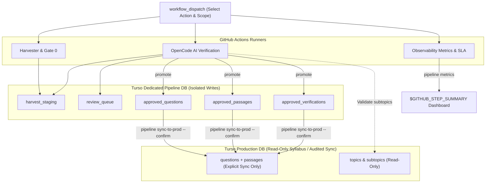

# Orchestration, CI/CD & Exception Review — utmelab-pipeline

**Parent System:** UTME Lab Pipeline  
**Module:** `pipeline.orchestrator` & `.github/workflows`  
**Specification Date:** 2026-10-14

---

## 1. High-Throughput CI/CD with GitHub Actions Matrix

Instead of sequentially running crawls or AI tasks on a local machine, the pipeline is designed to execute as distributed matrix jobs on GitHub Actions.



### GitHub Actions Workflow Specification (`.github/workflows/ai_process_staging.yml`)

```yaml
name: AI Process Staging Queue

on:
  workflow_dispatch:
    inputs:
      exam:
        description: 'Exam body'
        required: true
        default: 'JAMB'
        type: choice
        options: ['JAMB', 'WAEC', 'NECO']
      subjects:
        description: 'JSON list of subjects'
        required: true
        default: '["mathematics", "physics", "chemistry", "biology"]'
      batch_limit:
        description: 'Questions per subject per runner'
        required: false
        default: '50'
      concurrency:
        description: 'Worker concurrency'
        required: false
        default: '4'

jobs:
  process_matrix:
    runs-on: ubuntu-latest
    strategy:
      fail-fast: false
      matrix:
        subject: ${{ fromJson(github.event.inputs.subjects) }}
    steps:
      - name: Checkout Repository
        uses: actions/checkout@v4

      - name: Set up Python 3.12
        uses: actions/setup-python@v5
        with:
          python-version: '3.12'

      - name: Install OpenCode CLI
        run: |
          curl -fsSL https://opencode.ai/install.sh | bash
          echo "$HOME/.opencode/bin" >> $GITHUB_PATH

      - name: Install Pipeline Dependencies
        run: |
          python -m pip install --upgrade pip uv
          uv pip install -e "utmelab-pipeline/[dev]" --system

      - name: Run AI Processing & Auto-Promotion
        env:
          TURSO_PIPELINE_DB_URL: ${{ secrets.TURSO_PIPELINE_DB_URL }}
          TURSO_PIPELINE_DB_TOKEN: ${{ secrets.TURSO_PIPELINE_DB_TOKEN }}
          TURSO_PROD_DB_URL: ${{ secrets.TURSO_PROD_DB_URL }}
          TURSO_PROD_DB_TOKEN: ${{ secrets.TURSO_PROD_DB_TOKEN }}
        run: |
          pipeline process \
            --exam ${{ github.event.inputs.exam }} \
            --subject ${{ matrix.subject }} \
            --limit ${{ github.event.inputs.batch_limit }} \
            --concurrency ${{ github.event.inputs.concurrency }} \
            --auto-promote
```

---

## 2. In-Runner Concurrency Pool

Inside each matrix runner, the process runs asynchronously using `asyncio.Semaphore` to cap concurrent OpenCode subprocess executions:

```python
import asyncio

async def worker_pool(questions: list, concurrency: int = 4):
    sem = asyncio.Semaphore(concurrency)
    
    async def process_one(q):
        async with sem:
            return await process_question(q)
            
    tasks = [process_one(q) for q in questions]
    return await asyncio.gather(*tasks, return_exceptions=True)
```

At `concurrency = 4`, a batch of 50 questions completes in **under 2 minutes** per subject runner, completely free of charge.

---

## 3. Confidence Gating & Exception Handling

Questions are categorized automatically based on the AI evaluation:

1. **Auto-Promote Tier**:
   - `confidence >= 0.85`
   - `answer_check == "VERIFIED"`
   - `subtopic_slug` matches an active syllabus subtopic in Turso.
   - Action: Written directly to production `questions` + `verifications` table.
2. **Review Queue Tier (Exceptions)**:
   - `answer_check == "DISAGREEMENT"` (the model claims the official key is wrong).
   - `confidence < 0.85`.
   - `missing_referenced_figure` or figure parsing failure.
   - Action: Inserted into `review_queue` table in Pipeline Turso with priority flags.

---

## 4. The Role of MCP (`api.utmelab.com/mcp`)

- **High-Throughput Batch Workflows (CI/CD)**:
  Direct HTTP LibSQL connection (`libsql_client`) provides minimal latency and maximum throughput.
- **Interactive Exception Triage (MCP)**:
  The Model Context Protocol endpoint at `https://api.utmelab.com/mcp` serves as an interactive administration interface for coding agents and developers:
  - `list_review_queue(subject, priority)`: Lists flagged questions requiring human/agent attention.
  - `inspect_question(question_id)`: Fetches stem, options, diagram image, and model reasoning.
  - `resolve_question(question_id, corrected_key, corrected_subtopic, promote=True)`: Resolves an exception and triggers promotion to the production bank.

---

## 5. Operator CLI (`pipeline`)

The pipeline includes a clean Click-based CLI for development and operations:

```bash
# 1. Harvest from an external source into Pipeline DB
pipeline harvest --source jamb --subject physics --year 2025 --limit 100

# 2. Run Gate 0 check on pending staging questions
pipeline gate check --subject physics

# 3. Process staging queue with multimodal AI
pipeline process --subject physics --concurrency 4 --auto-promote

# 4. Inspect flagged exceptions
pipeline review list --status open

# 5. Resolve an exception and promote
pipeline review resolve stage_q_12345 --answer b --subtopic wave-particle-duality
```
