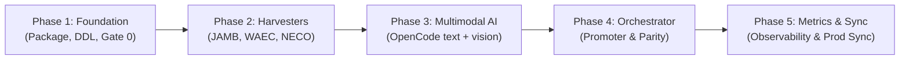

# Roadmap & Implementation Milestones — utmelab-pipeline

**Parent System:** UTME Lab Pipeline  
**Target Architecture:** Distributed Python Pipeline + Dedicated Turso DB  
**Specification Date:** 2026-10-15  
**Status:** ALL PHASES COMPLETE & PRODUCTION READY 🟢

---

## Phased Execution Plan

---

### Phase 1: Core Foundation & Database Schema
**Status:** [x] COMPLETE

- [x] Initialized `pyproject.toml` with `uv` build toolchain (`libsql-client`, `pydantic`, `httpx`, `click`, `pytest`).
- [x] Implemented `pipeline/storage/client.py` and executed schema DDL for `scrape_runs`, `harvest_staging`, `review_queue`, `approved_questions`, `approved_passages`, and `approved_verifications`.
- [x] Implemented `pipeline/gates/mechanical.py` (stem checks, option count/uniqueness, answer key validation, promised figure and passage checks).
- [x] Implemented `pipeline/gates/dedupe.py` (SHA-256 normalized stem fingerprinting).
- [x] Wrote unit tests for Gate 0 with mock dirty payloads (all passing).

---

### Phase 2: Pluggable Multi-Source Harvesters
**Status:** [x] COMPLETE

- [x] Created `pipeline/sources/base.py` (`RawQuestionPayload`, `BaseHarvester`).
- [x] Built `pipeline/sources/jamb.py` (JAMB archive crawler with rate-limiting, session rotation, diagram extraction, and passage stimulus extraction).
- [x] Built `pipeline/sources/waec.py` (WAEC portal crawler for objective papers with passage stimulus extraction).
- [x] Built `pipeline/sources/neco.py` (NECO SSCE crawler with 5 options `a`..`e`, diagram OCR, and passage extraction).
- [x] Wired `pipeline harvest` CLI command to stream raw questions through Gate 0 directly into `harvest_staging`.

---

### Phase 3: Multimodal AI Engine (OpenCode Free Tier)
**Status:** [x] COMPLETE

- [x] Implemented `pipeline/media/downloader.py` (downloads diagrams, computes SHA-256, caches locally).
- [x] Implemented `pipeline/ai/runner.py` (cascades through `openrouter/openrouter/free`, `opencode/space-bunny-free`, `opencode/muse-spark-1.3-contributor-free`).
- [x] Implemented `pipeline/ai/prompts.py` (hierarchical syllabus pruning from live Turso catalog + passage stimulus injection).
- [x] Implemented `pipeline/ai/schemas.py` and `tasks.py` (Pydantic validation, diagram orientation detection, audit report generation).
- [x] Live end-to-end multimodal proof on mathematics pie chart `74197` (OCR'd sectors, validated $60^\circ$ answer key, subtopic mapped).

---

### Phase 4: Batch Orchestrator & Promotion Engine
**Status:** [x] COMPLETE

- [x] Implemented `pipeline/orchestrator/worker.py` (bounded `asyncio.Semaphore` pool).
- [x] Implemented `pipeline/orchestrator/promoter.py`:
  - Strict database isolation: writes to `approved_questions`, `approved_passages`, `approved_verifications` in Pipeline DB.
  - Rust byte parity: 100% SHA-256 match to `Question::content_fingerprint` with `\u001f` delimiter.
  - Image mark anchoring: deterministic (start, len, position).
  - Passage stimulus deduplication and automatic linking.
- [x] Implemented exception routing into `review_queue`.

---

### Phase 5: Observability Metrics & Production Sync
**Status:** [x] COMPLETE

- [x] Built `pipeline/metrics/collector.py` & `pipeline metrics`:
  - Conversion funnel & throughput (staged -> Gate 0 admitted -> AI processed -> approved).
  - Gate 0 mechanical quality histogram & rejection reason breakdown.
  - Multimodal AI telemetry (verdict distribution, average confidence, confidence rating buckets).
  - Exam x Subject coverage matrix.
  - Review queue SLA backlog tracking.
  - Terminal CLI dashboard & GitHub Actions `$GITHUB_STEP_SUMMARY` Markdown generation.
- [x] Built `pipeline/orchestrator/sync_prod.py` & `pipeline sync-to-prod`:
  - Safe, controlled promotion from Pipeline DB to Production Turso DB.
  - Default DRY-RUN mode; requires explicit `--confirm` to commit writes.
  - Pre-flight relational integrity checks (foreign key subtopic existence, stimulus linking, byte-hash parity).
- [x] Updated GitHub Actions workflow `.github/workflows/pipeline.yml` with automated test execution, actions dispatch (`harvest`, `process`, `promote`, `metrics`, `status`, `sync-to-prod`), and post-job observability summaries.
