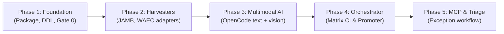

# Roadmap & Implementation Milestones — utmelab-pipeline

**Parent System:** UTME Lab Pipeline  
**Target Architecture:** Distributed Python Pipeline + Dedicated Turso DB  
**Specification Date:** 2026-10-14

---

## Phased Execution Plan

---

### Phase 1: Core Foundation & Database Schema
**Goal:** Establish the independent Python environment, connect to the dedicated Pipeline Turso DB, and implement Gate 0 mechanical validation.

- [ ] Initialize `pyproject.toml` with `uv` build toolchain (`libsql-client`, `pydantic`, `httpx`, `click`, `pytest`).
- [ ] Implement `pipeline/storage/client.py` and execute the schema DDL for `scrape_runs`, `harvest_staging`, and `review_queue`.
- [ ] Implement `pipeline/gates/mechanical.py` (stem checks, option integrity, answer key validation).
- [ ] Implement `pipeline/gates/dedupe.py` (SHA-256 normalized stem fingerprinting).
- [ ] Write unit tests for Gate 0 with mock dirty payloads.

---

### Phase 2: Pluggable Multi-Source Harvesters
**Goal:** Implement the uniform `BaseHarvester` interface and build adapters for target examination bodies.

- [ ] Create `pipeline/sources/base.py` (`RawQuestionPayload`, `BaseHarvester`).
- [ ] Build `pipeline/sources/jamb.py` (JAMB archive crawler with rate-limiting and session rotation).
- [ ] Build `pipeline/sources/waec.py` (WAEC portal crawler for objective papers).
- [ ] Wire the `pipeline harvest` CLI command to stream raw questions through Gate 0 directly into `harvest_staging`.

---

### Phase 3: Multimodal AI Engine (OpenCode Free Tier)
**Goal:** Implement asynchronous OpenCode CLI execution supporting both text reasoning and local image inspection.

- [ ] Implement `pipeline/media/downloader.py` (downloads diagrams, computes SHA-256, caches locally).
- [ ] Implement `pipeline/ai/runner.py` (executes `opencode run` via stdin with optional `-f` image flag).
- [ ] Implement `pipeline/ai/prompts.py` (hierarchical syllabus pruning from live Turso catalog).
- [ ] Implement `pipeline/ai/schemas.py` and `tasks.py` (Pydantic validation, underline offset snapping).
- [ ] End-to-end test on both text-only items (`space-bunny-free`) and diagram items (`muse-spark-1.3-free`).

---

### Phase 4: Batch Orchestrator & Promotion Engine
**Goal:** Connect the staging queue to the AI worker pool and automate promotion to production Turso.

- [ ] Implement `pipeline/orchestrator/worker.py` (bounded `asyncio.Semaphore` pool).
- [ ] Implement `pipeline/orchestrator/promoter.py`:
  - Enforce confidence thresholds (`confidence >= 0.85` and `answer_check == "VERIFIED"`).
  - Format canonical RichText questions.
  - Execute atomic write to production Turso (`questions` + `verifications`).
  - Move unverified/discrepancy items to `review_queue`.
- [ ] Add `.github/workflows/ai_process_staging.yml` for distributed matrix runs across subjects.

---

### Phase 5: Exception Review & MCP Integration
**Goal:** Provide seamless tools for resolving edge cases and reviewing flagged questions.

- [ ] Build `pipeline review` CLI commands to inspect, approve, or correct items in `review_queue`.
- [ ] Scaffold MCP tools for `https://api.utmelab.com/mcp` allowing developers/agents to triage exceptions directly from their coding environment.
- [ ] Finalize end-to-end integration and run production verification across backlogged subjects (Physics, WAEC Computer Studies).
